# HelloDuo

A test app that shows the iOS SDK it was built with, its minimum iOS version, its iPhone orientations and whether `UIRequiresFullScreen` is set. It's used to compare how orientation settings and the build SDK affect rotation and resizing on the iPhone Duo's inner and outer screens: whether the app fills the screen, runs in a smaller window, or is letterboxed/pillarboxed.

## Build variants

`build-variants.sh` builds one simulator app per variant into `builds/`. Each variant has its own bundle ID and home-screen name, so they can be installed side by side.

| Variant | iPhone orientations | `UIRequiresFullScreen` | Home-screen name |
|---|---|---|---|
| No lock | Portrait, Landscape Left, Landscape Right | not set | Duo *SDK* |
| Portrait lock | Portrait | not set | Duo *SDK* P |
| Portrait lock + full screen | Portrait | YES | Duo *SDK* PF |
| Landscape lock + full screen | Landscape Left, Landscape Right | YES | Duo *SDK* LF |

To build with a specific Xcode:

```
DEVELOPER_DIR=/Applications/Xcode-27.1.0.app/Contents/Developer ./build-variants.sh
```

## iPhone Duo screenshots

These screenshots were taken on the iPhone Duo simulator (iOS 27.1 runtime): open for the inner screen, closed for the outer screen. They are captured from the DeviceHub window, so they include the device frame. Each app was launched in portrait and then rotated to landscape while it was running.

The inner screen is 951×669 points in landscape and 669×951 in portrait (2853×2007 pixels at 3× scale). The outer screen is 678×466 points in landscape and 466×678 in portrait (2034×1398 pixels at 3× scale). Window sizes under each screenshot are the app window, in points, as drawn on screen, measured from full-resolution simulator screenshots.

## SDK 26.5

### Inner screen

| Variant | Landscape | Portrait |
| --- | --- | --- |
| No lock | <br>376×669, centered | <br>375×667, centered |
| Portrait lock | <br>376×669, centered | <br>375×667, centered |
| Portrait lock + full screen | <br>376×669, centered | <br>375×667, centered |
| Landscape lock + full screen | 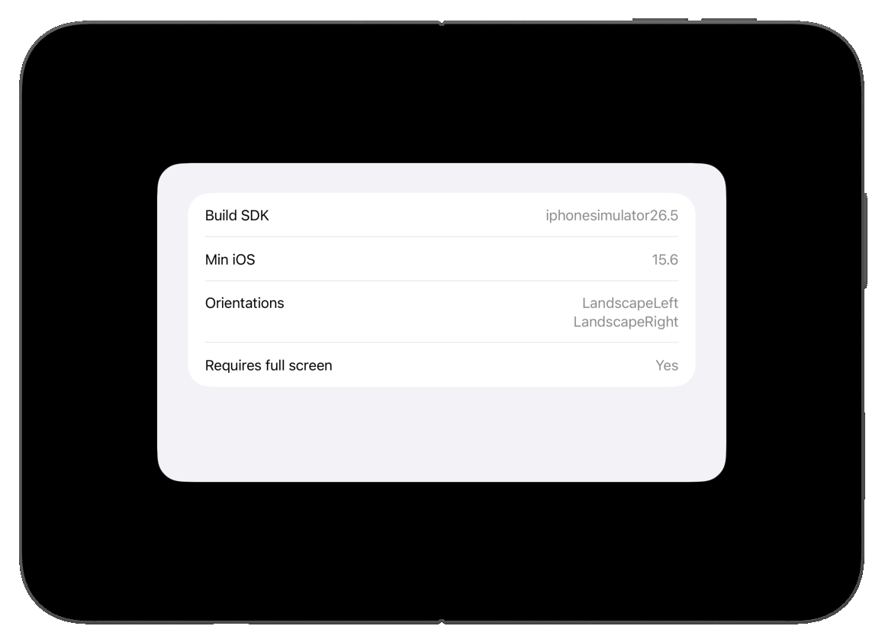<br>667×375, centered | 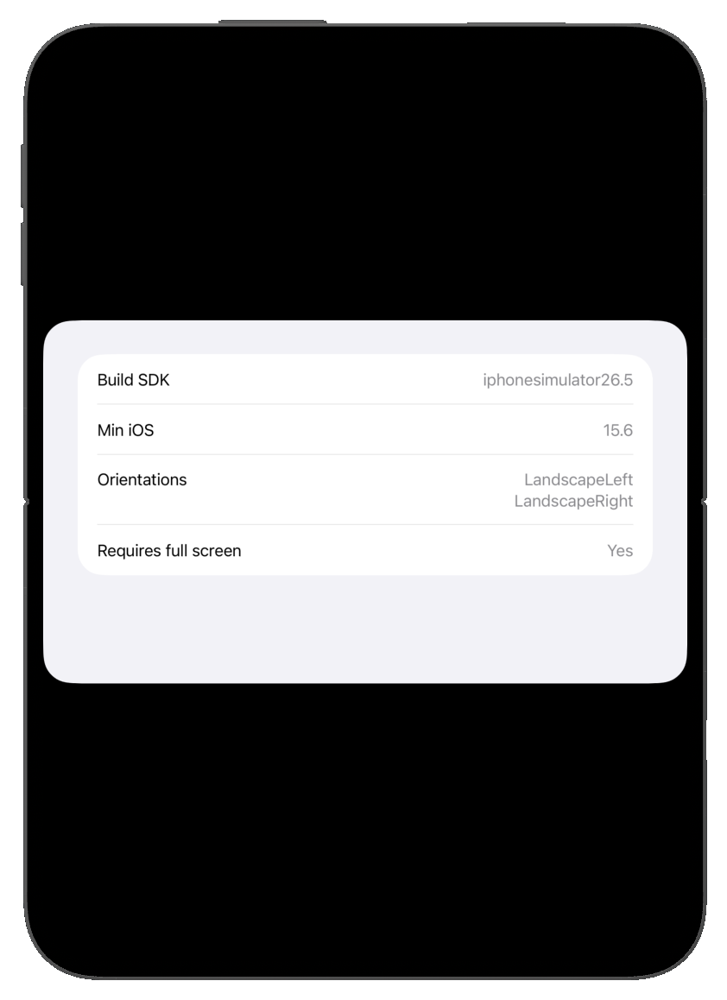<br>669×376, centered |

- **The app runs in an iPhone-sized compatibility window.** It gets a window the size of an iPhone SE, centered with black around it.
  - Builds that support portrait get a portrait window: 375×667 in portrait. In landscape it stays portrait-shaped and runs the full screen height (376×669).
  - The landscape-locked build gets a landscape window: 667×375 in landscape. In portrait it stays landscape-shaped and runs the full screen width (669×376).
- **Zoom and rotate buttons.**
  - In portrait, the system shows a zoom button in the bottom-right corner of the screen. Tapping it scales the window up to fill the screen height (534×951). The zoom button is removed in landscape.
  - The no-lock build also shows a rotate button, in both orientations.
  - The landscape-locked build shows neither button.
- **Portrait lock and `UIRequiresFullScreen` make no difference** to the window, apart from those buttons. Landscape lock only changes the window's shape.

### Outer screen

| Variant | Landscape | Portrait |
| --- | --- | --- |
| No lock | 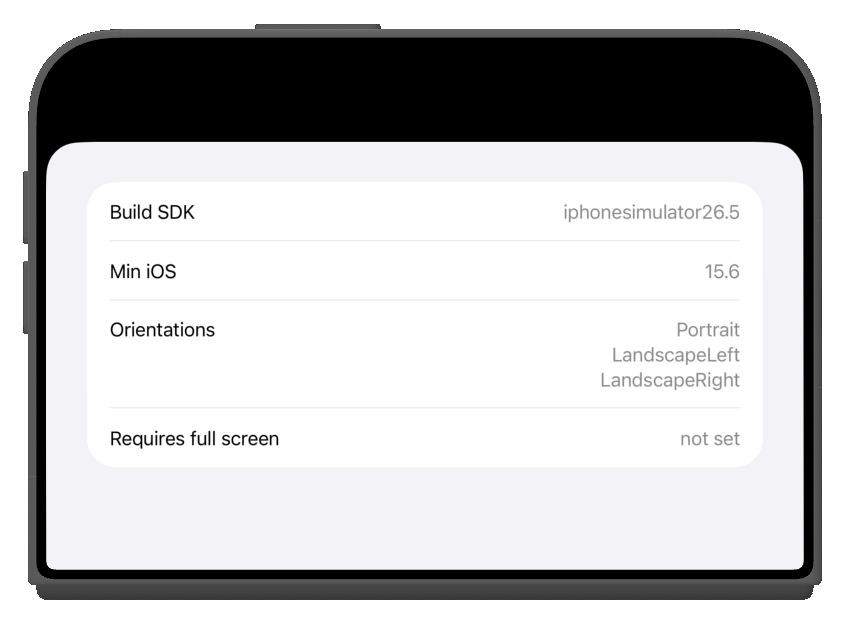<br>678×381 | 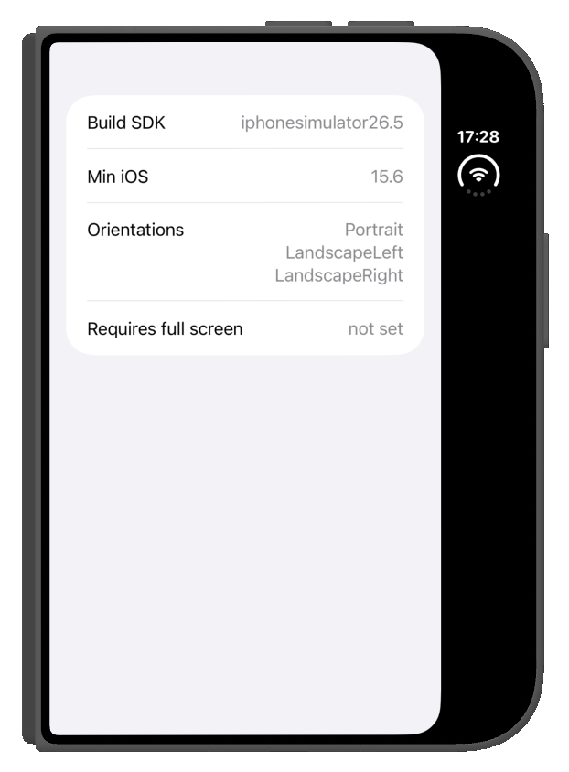<br>381×678 |
| Portrait lock | 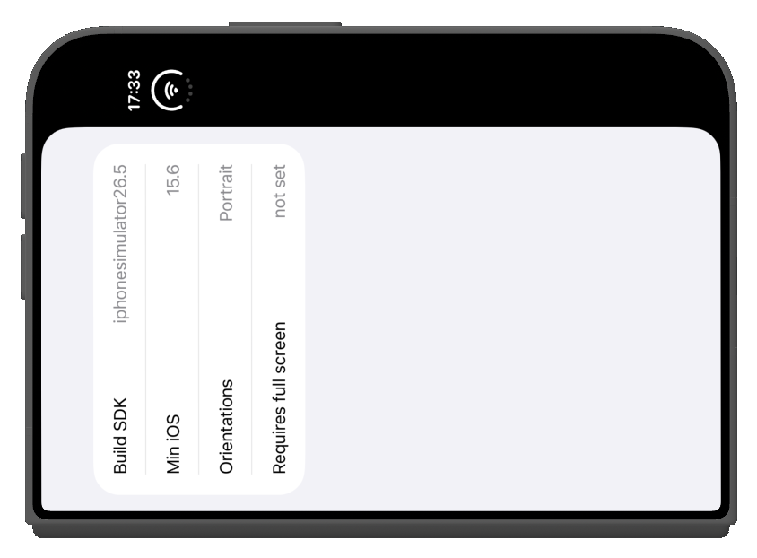<br>381×678, stays portrait | 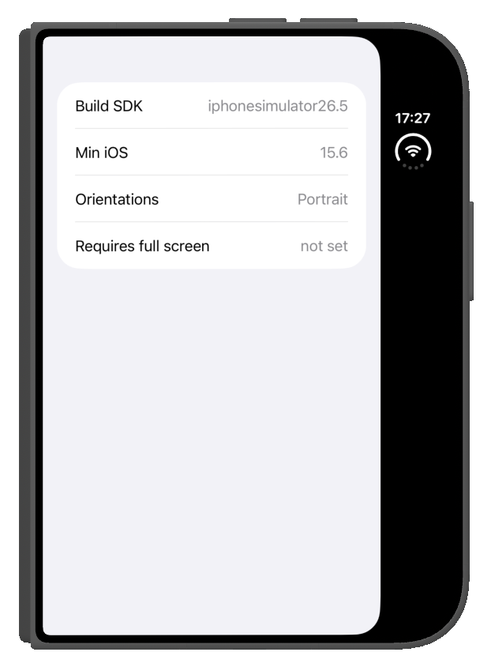<br>381×678 |
| Portrait lock + full screen | <br>381×678, stays portrait | 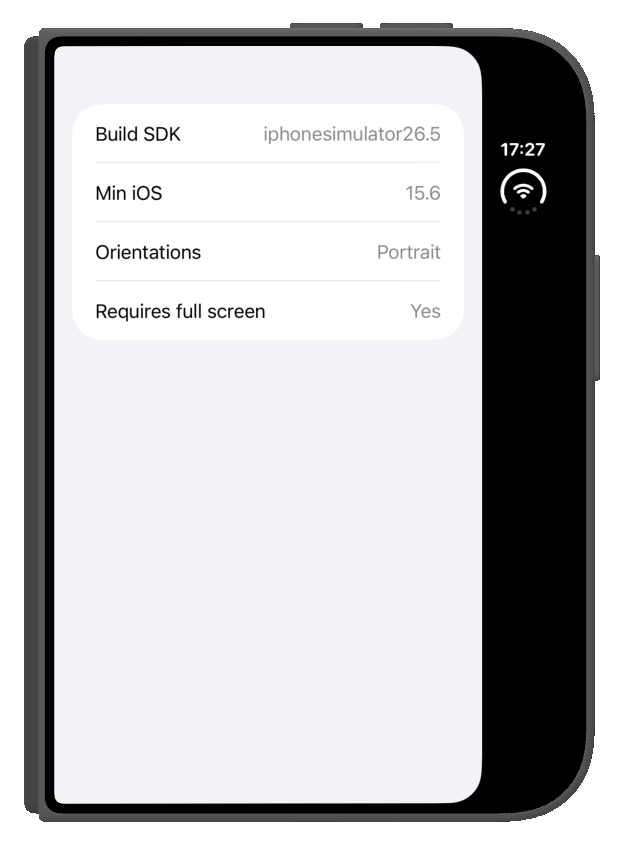<br>381×678 |
| Landscape lock + full screen | 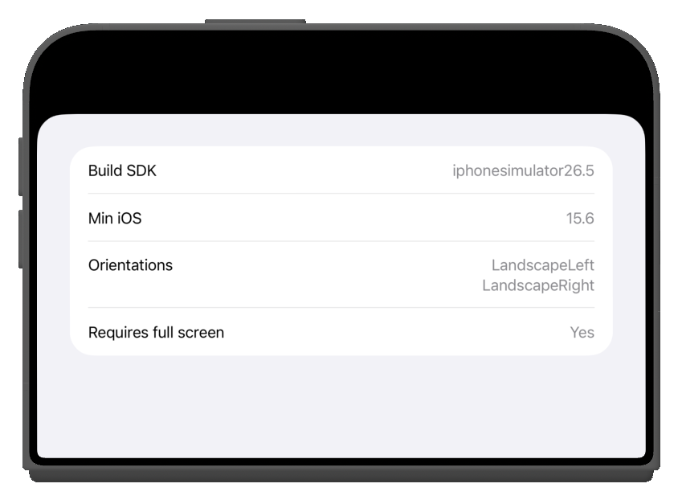<br>678×381 | 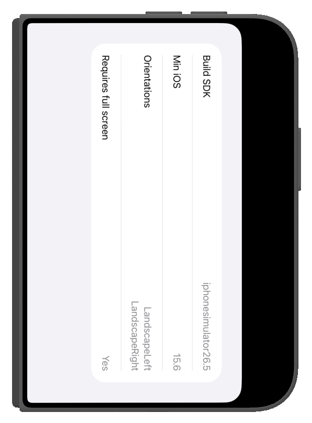<br>678×381, stays landscape |

- **The app fills the screen, minus the status bar.** There is no compatibility window on the outer screen. The window stops short of an 85-point black strip for the status bar: down the right side in portrait and along the top in landscape.
- **Orientation lock works.** Portrait-locked builds stay portrait when the device is turned to landscape, and the landscape-locked build stays landscape when it is turned to portrait, as on a regular iPhone.
- **`UIRequiresFullScreen` makes no difference.**

## SDK 27.0

### Inner screen

| Variant | Landscape | Portrait |
| --- | --- | --- |
| No lock | <br>871×669 | <br>669×871 |
| Portrait lock | <br>871×669 | <br>669×871 |
| Portrait lock + full screen | <br>469×669, centered | <br>669×871 |
| Landscape lock + full screen | <br>871×669 | 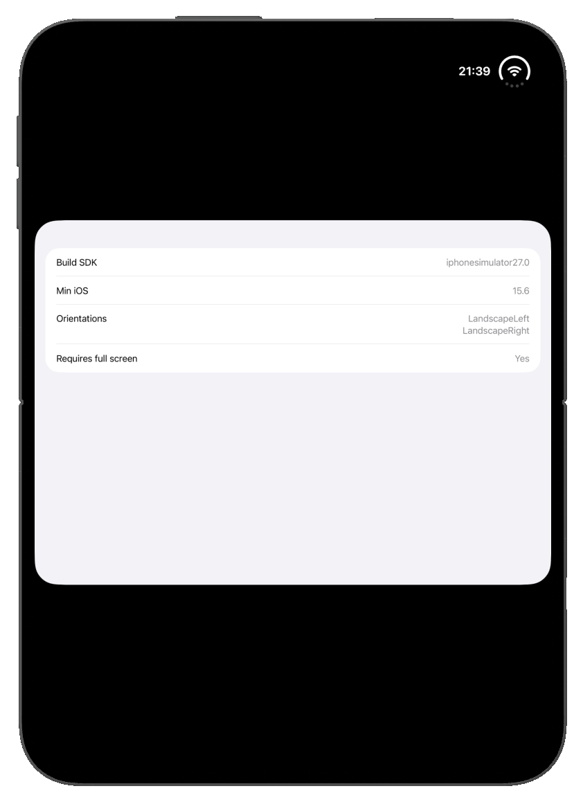<br>669×470, centered |

- **Without `UIRequiresFullScreen` the app fills the screen, minus the status bar.** The window stops short of the status bar, leaving an 80-point black strip for it: along the top in portrait and down the right side in landscape.
- **Portrait lock on its own is ignored.** The portrait-locked app rotates to landscape and fills the screen, the same as the unlocked app.
- **Portrait lock plus `UIRequiresFullScreen` keeps the app in portrait.** In landscape the app stays portrait, centered with black bars on each side.
  - That's the inner screen's portrait shape at the full landscape height. Content is drawn at normal size, not scaled.
  - Its window is roughly 25% wider (SDK 27: 469pt vs SDK 26: 376pt).
- **Landscape lock plus `UIRequiresFullScreen` keeps the app in landscape.** In portrait the app stays landscape, centered with black bars above and below.
  - Its window is roughly 25% taller (SDK 27: 470pt vs SDK 26: 376pt).

### Outer screen

| Variant | Landscape | Portrait |
| --- | --- | --- |
| No lock | 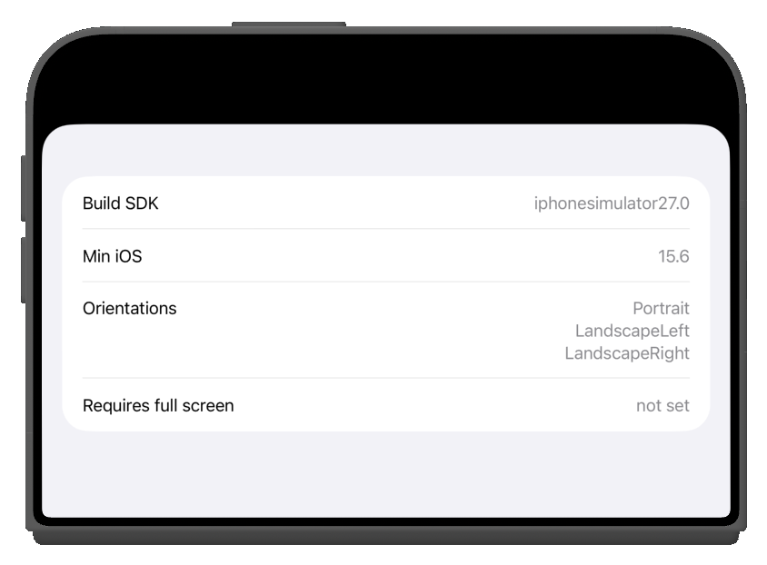<br>678×386 | 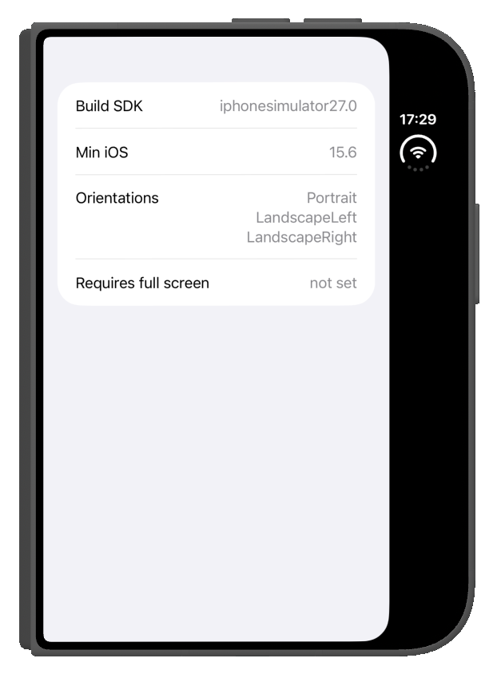<br>386×678 |
| Portrait lock | <br>386×678, stays portrait | 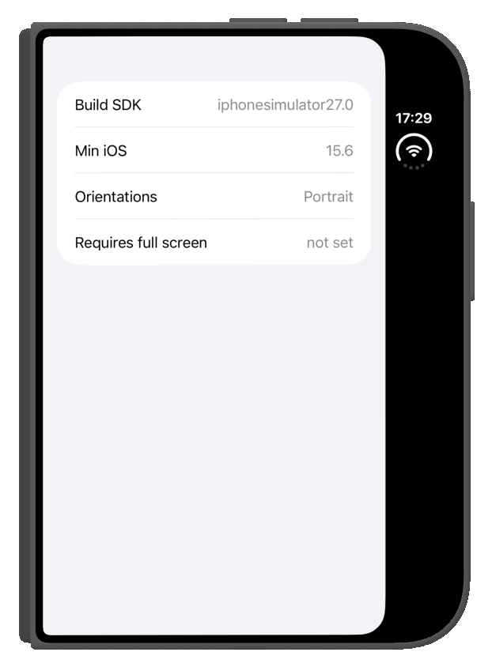<br>386×678 |
| Portrait lock + full screen | 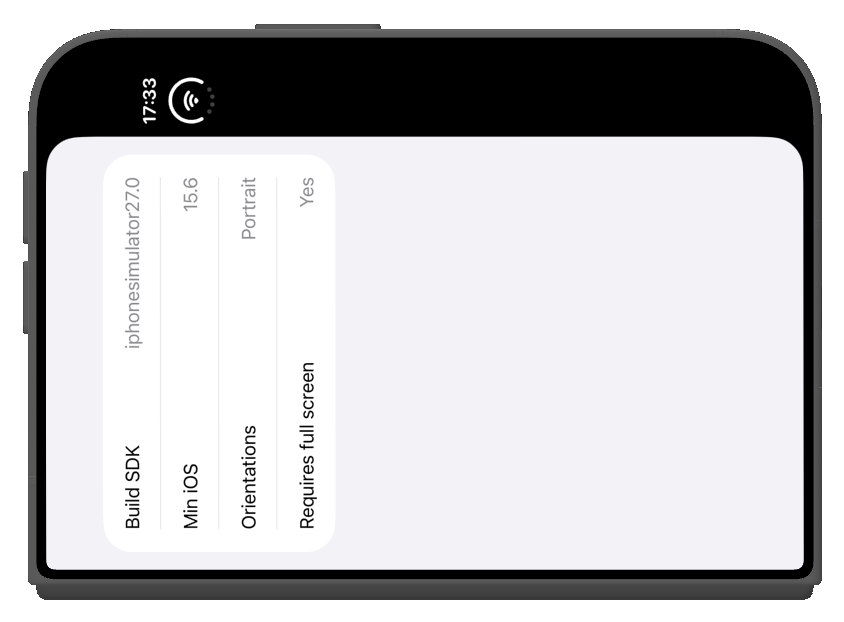<br>386×678, stays portrait | 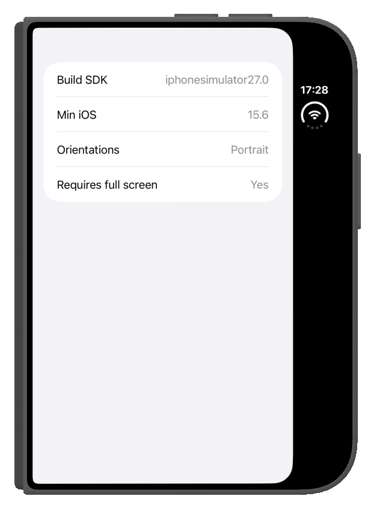<br>386×678 |
| Landscape lock + full screen | <br>678×386 | 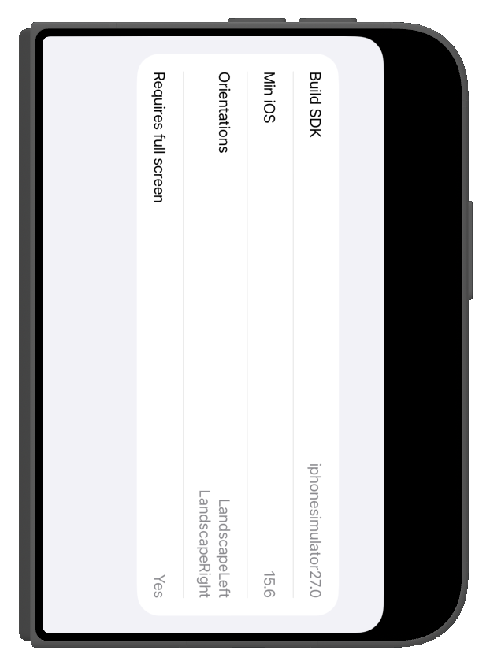<br>678×386, stays landscape |

- **The app fills the screen, minus the status bar.** The window stops short of an 80-point black strip for the status bar: down the right side in portrait and along the top in landscape.
- **Orientation lock works.** Portrait-locked builds stay portrait when the device is turned to landscape, and the landscape-locked build stays landscape when it is turned to portrait, as on a regular iPhone.
- **`UIRequiresFullScreen` makes no difference.**

## SDK 27.1

### Inner screen

| Variant | Landscape | Portrait |
| --- | --- | --- |
| No lock | <br>951×669 (full screen) | <br>669×951 (full screen) |
| Portrait lock | <br>951×669 (full screen) | <br>669×951 (full screen) |
| Portrait lock + full screen | <br>469×669, centered | <br>669×951 (full screen) |
| Landscape lock + full screen | 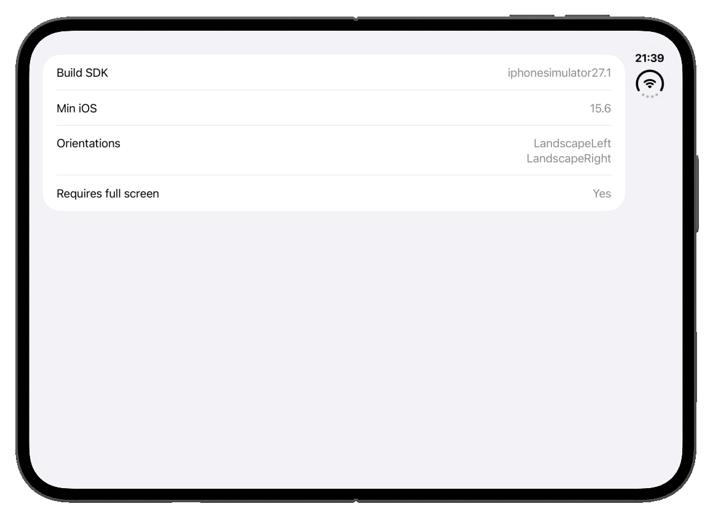<br>951×669 (full screen) | 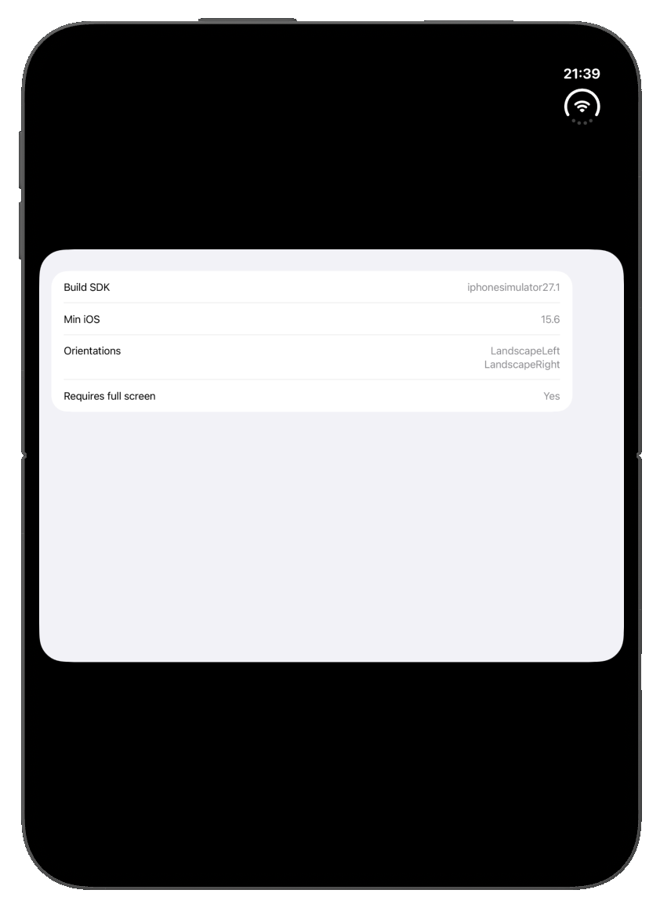<br>669×470, centered |

- **Without `UIRequiresFullScreen` the app fills the whole screen.** It runs edge to edge, with the status bar drawn over the app's background.
- **Portrait lock on its own is ignored.** The portrait-locked app rotates to landscape and fills the screen, the same as the unlocked app.
- **Portrait lock plus `UIRequiresFullScreen` keeps the app in portrait.** In landscape the app stays portrait, centered with black bars on each side, as with SDK 27.0.
  - Its window is roughly 25% wider (SDK 27.1: 469pt vs SDK 26: 376pt).
  - Compared with 27.0, the app adds space above its content inside the portrait window.
- **Landscape lock plus `UIRequiresFullScreen` keeps the app in landscape.** In portrait the app stays landscape, centered with black bars above and below, as with SDK 27.0.
  - Its window is roughly 25% taller (SDK 27.1: 470pt vs SDK 26: 376pt).

### Outer screen

| Variant | Landscape | Portrait |
| --- | --- | --- |
| No lock | 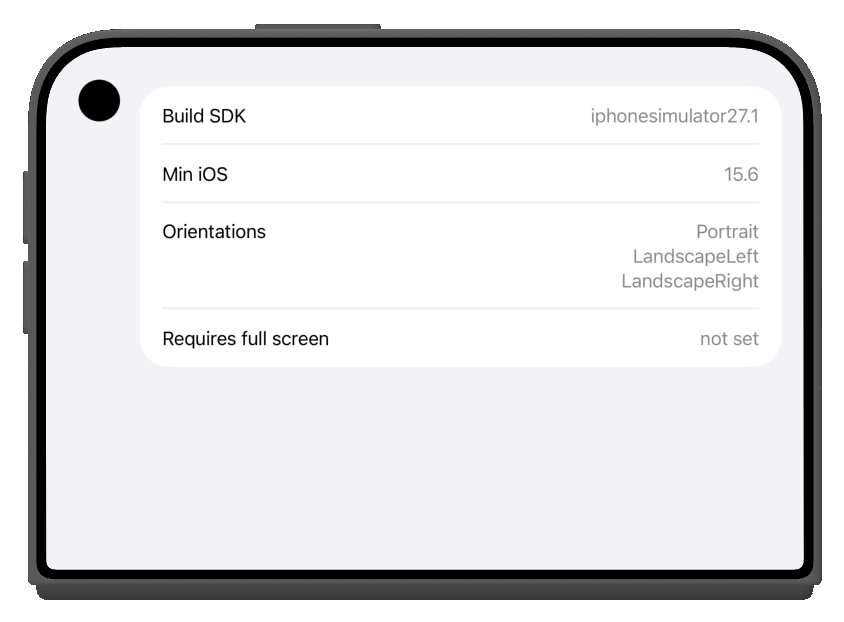<br>678×466 (full screen) | 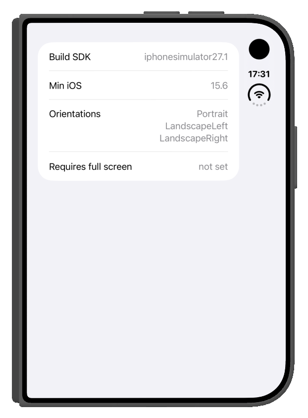<br>466×678 (full screen) |
| Portrait lock | <br>466×678 (full screen), stays portrait | 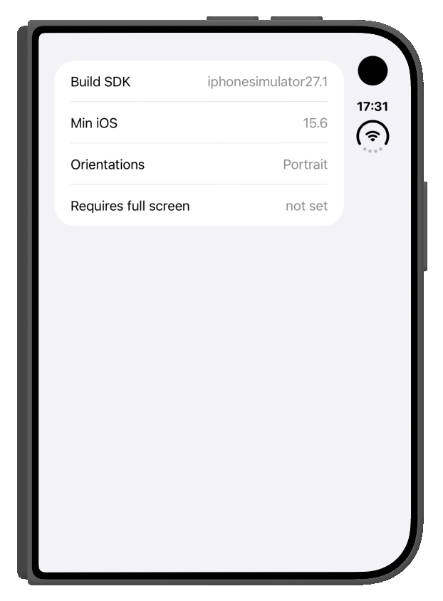<br>466×678 (full screen) |
| Portrait lock + full screen | 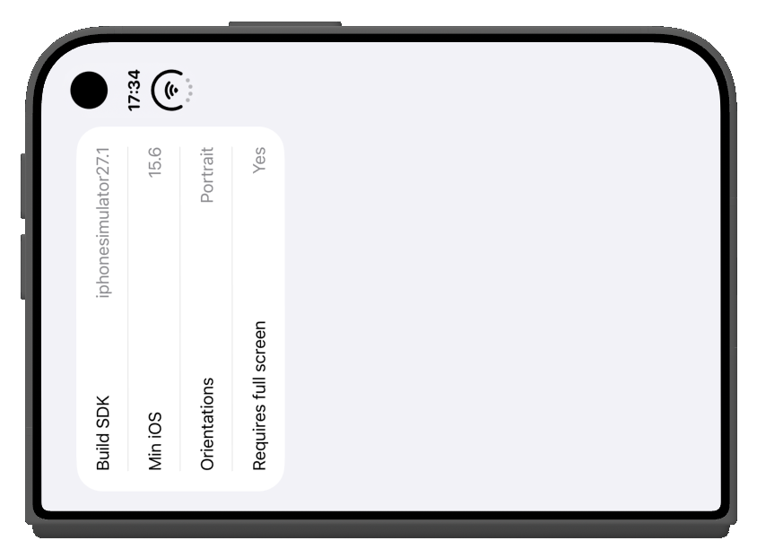<br>466×678 (full screen), stays portrait | 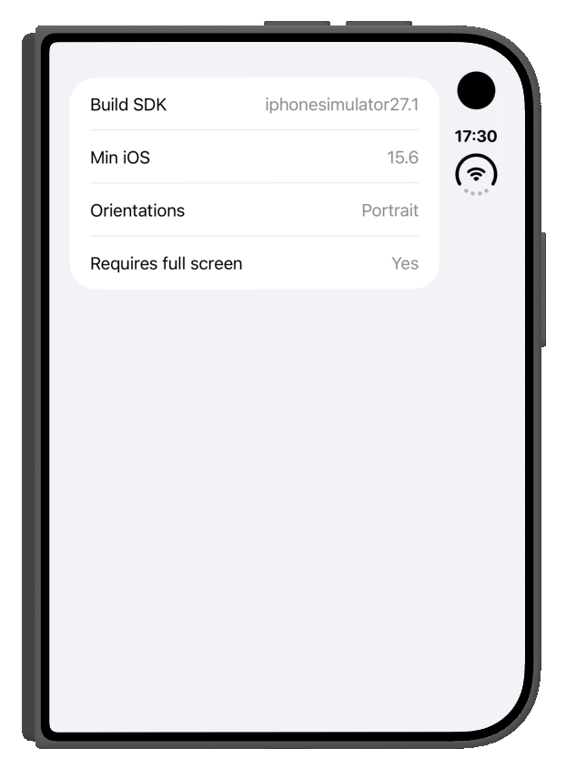<br>466×678 (full screen) |
| Landscape lock + full screen | 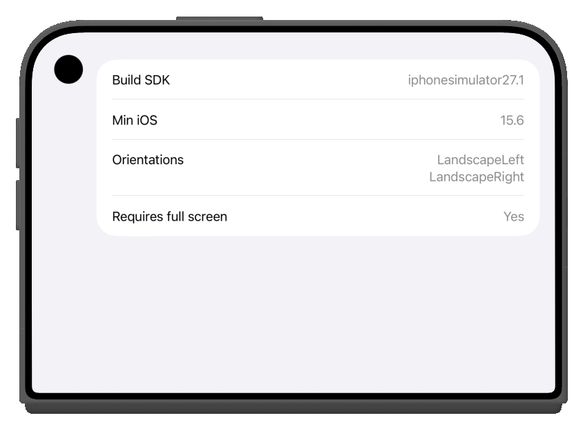<br>678×466 (full screen) | 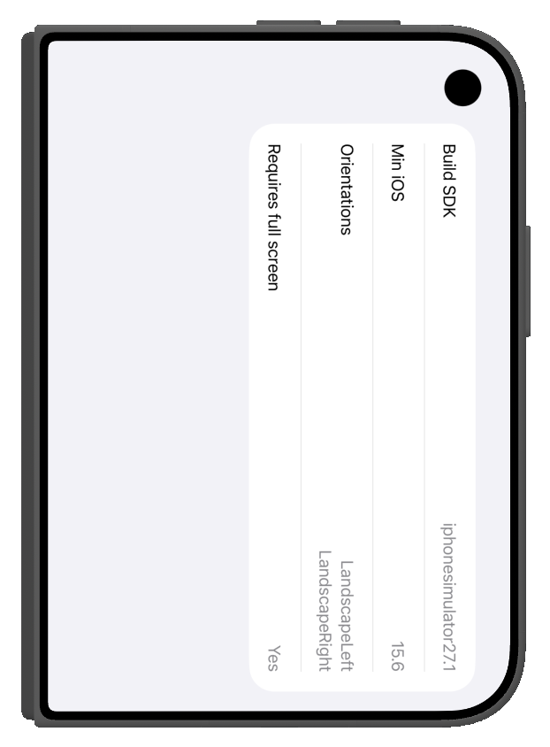<br>678×466 (full screen), stays landscape |

- **The app fills the whole screen.** It runs edge to edge, with the status bar drawn over the app. In landscape the camera cutout sits over the top-left of the content.
- **Orientation lock works.** Portrait-locked builds stay portrait when the device is turned to landscape, and the landscape-locked build stays landscape when it is turned to portrait, as on a regular iPhone.
- **`UIRequiresFullScreen` makes no difference.**
